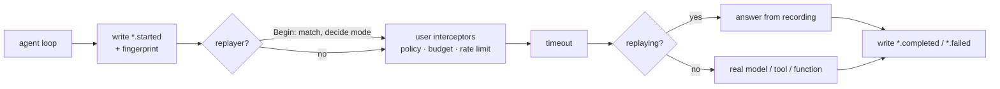

# Architecture

How agentflow records agent runs, and how it replays them against new code.

## The idea in one paragraph

Everything nondeterministic an agent does goes through one **effect boundary**: model calls, tool calls, context lookups, and anything wrapped in `agentflow.Do`. At the boundary each effect is recorded in a **trace**: its request (with a fingerprint) and its outcome. Replay runs your *current* code against a recorded trace. Every effect request the new run makes is compared with the recording. A match is answered from the recording without touching the world. The first mismatch is a **divergence**, reported down to the field that changed. Agents can start other agents; every run a top-level invocation causes lands in its trace as a **tree**, and a team replays as a tree, each run against its own recording, so a divergence is reported in the run that caused it.

## Concepts

| Term | Meaning |
|---|---|
| **Trace** | Everything recorded for one top-level invocation. A replay produces a new trace whose *origin* points back to the source. |
| **Run** | One execution of one task by an agent or a workflow. Runs in a trace form a tree; each has a path (`/` for the root, `/metrics#0/sql#0` for a grandchild) that is the same in a recording and its replays. |
| **Event** | One immutable record in a run, numbered by `seq` (0, 1, 2, …), with no gaps. Order comes from `seq`, never from timestamps. |
| **Effect** | An interaction with the outside world, recorded as a `*.started` event and a `*.completed` / `*.failed` event. |
| **Conversation** | The messages a run has accumulated, defined exactly by its `message.appended` events. |

## Packages

```
agentflow/            Agent, Workflow, Spawn/SpawnAll/Delegate, effect boundary, interceptors, Do/Now/NewID
  llm/                messages and content blocks, Request/Response, the Model interface (stdlib only)
  trace/              event format, canonical JSON + fingerprints, conversation fold, Store, Writer, bundles
  trace/canonical/    RFC 8785 JSON canonicalization
  trace/filestore/    JSONL file store with content-addressed blobs
  trace/memstore/     in-memory store
  replay/             replay engine, divergence reports, trace diff
  policy/             interceptors: permissions, token budget, rate limit
  agentflowtest/      scripted models and cassettes for go test
  schema/             JSON Schema validation of tool inputs
  mcp/                MCP client: server tools as agentflow tools
  cmd/agentflow/      CLI: runs, show, diff, export
  providers/          separate modules: anthropic, openai, retry
  observe/otel/       separate module: OpenTelemetry tracer and metrics observers
```

Providers depend only on `llm`, never on the runtime. The core modules depend on the standard library plus `google/uuid`.

## The agent loop

```
run.started, message.appended(task)
loop (up to MaxSteps):
    context providers  ──► effect "context.<name>"   (ephemeral messages for this call)
    model call         ──► llm.started / llm.completed, message.appended
    no tool calls?     ──► run.finished(completed)
    tool calls         ──► tool.started × n  →  run (concurrently if allowed)  →  tool.completed × n
                           message.appended(tool results)
```

Tool calls from one model response form a **batch**. All `tool.started` events are written in response order, the tools run (up to `MaxParallelTools` at once), and the completions are written in response order. A trace's layout therefore never depends on which tool finished first, or on the parallelism setting.

## Teams: run trees

Agents start other agents in two ways, and both produce the same tree:

- **Delegation (LLM-driven):** `agentflow.Delegate(researcher, opts)` is a tool with input `{"task": string}`. The model calls it; the runtime starts a child run of `researcher` on the task and returns the child's output as the tool result. The child has its own conversation: it sees the task, not the parent's history.
- **Workflows (code-driven):** `agentflow.NewWorkflow(name, fn)` is a run whose body is Go code. It starts children with `Spawn` (one, waiting for it) and `SpawnAll` (several, concurrently). A workflow reaches models only through agents.

Calling `agent.Run(ctx, …)` with a context that belongs to a run in progress (inside a tool, or in workflow code) is the same as `Spawn`: the child joins the tree instead of starting an unrelated trace. Starting a child inside a `Do` function or a context provider is an error (`ErrSpawnInsideEffect`), since that effect's recorded outcome would cover the child.

Starting a child is an effect, **`spawn`**: it passes through the interceptors (so policy can deny it), and the parent records `run.spawned` (with a fingerprint of `{agent, task, key}`) and `run.joined` (the child's status, output and subtree usage). The child writes its own run, linked by `run.started.parent.run_id`.

```
/                         workflow  incident-triage
├── /logs#0               agent     logs
├── /metrics#0            agent     metrics
│   └── /metrics#0/sql#0  agent     sql          (delegated by metrics' model via tool "query_db")
└── /summarizer#0         agent     summarizer
```

**Paths are deterministic.** A segment is `<agent>#<n>` (the parent's n-th child of that agent), or `<agent>@<key>` for an explicit `SpawnKey`. Ordinals follow spec order for `SpawnAll`, call order for `Spawn`, and response order for delegations, reserved before any child starts. A child started inside an ordinary tool gets a generated key, `<agent>@<step>.<call>.<n>`, because the calls of one response may run concurrently. No path depends on scheduling, so paths match runs across a recording, its replays and its forks.

**Limits** apply to the whole tree (`WithLimits`): depth (default 5), runs (64), and concurrently executing children (8; a run waiting for its own children gives up its slot, so nested delegation can't deadlock). A spawn beyond depth or run count is a recorded failure, `limit_exceeded`, that a delegating model sees as an error result. `WithInterceptors` and `WithObservers` on the top-level run apply to every run in the tree, for example one `policy.Budget` shared by a team. An agent's own `AgentConfig.Interceptors` and `Observers` apply to its runs only.

## The effect boundary

Every effect follows the same path:



- **Interceptors** may allow, deny, delay or observe a call, but never change its request. That guarantees the recorded request is the one sent.
- **Recordable failures vs aborts.** A failure that happened in the world is an outcome: it is recorded and replayed. Examples are a rate-limited model, a tool timeout, or a policy denial. A Go error from an interceptor means the runtime itself failed, and it aborts the run.
- **Panics** in tools, providers and context providers are recovered and recorded as failures.
- **Interceptor-produced outcomes are marked.** If an interceptor answered a call (e.g., a denial), the completion carries `"intercepted": true`. Replay never serves such an outcome as a world result. If the call now reaches the world, for example because the policy was removed, that is a divergence.

## Determinism rules

1. The runtime touches the world only through the boundary.
2. No decision depends on wall-clock time, randomness or map order. Clock and ID sources are injected, and are used only for event times and IDs, which are never compared.
3. Tool specs are sorted by name in every request.
4. Interceptors don't modify requests.
5. Tool batches record in response order.
6. Effects nested inside a tool call (a `Do` made by a tool, a child it starts) are buffered and written with their tool's completion. `SpawnAll` is a batch too: every `run.spawned` in order, the children concurrently, every `run.joined` in order. A concurrent `Do` or `Spawn` on the same run outside a batch fails with `ErrConcurrentEffect` instead of producing a nondeterministic trace.
7. A run that ends while an effect it started is unanswered (it diverged, failed, or was cancelled) records that effect's answer, as cancelled, before `run.finished`, and flushes an abandoned batch in batch order. Every start in a finished run has an answer, and every child is linked.

## Recording format

The full specification, written for implementers in any language, is [docs/spec/trace-v1.md](docs/spec/trace-v1.md), with a [JSON Schema](docs/spec/trace-v1.schema.json). CI validates the encoder and every committed fixture against the schema. In brief, each event is one JSON line:

```json
{"v":1,"trace_id":"…","run_id":"…","seq":5,"time":"2026-11-23T10:00:00.123456Z","kind":"tool.started","cause":3,
 "body":{"step":0,"call_id":"toolu_01","tool":"calculator","input":{"expression":"6*7"},"fingerprint":"sha256:…"}}
```

- **`cause`** links an event to the event it answers: a completion to its start, a tool call to the model response that requested it.
- **Requests are references.** `llm.started` records how many conversation messages the call used, plus any ephemeral messages and a fingerprint, instead of a copy of the whole history. `trace.Request(events, seq)` rebuilds the exact request. Storage grows linearly with run length.
- **Fingerprints** are SHA-256 of the RFC 8785 canonical JSON of what was sent to the model, so two requests compare equal exactly when they would be sent identically.
- **Content blocks** keep everything providers send, including reasoning blocks with their signatures, which must be sent back unchanged.
- **Large strings** (over 32 KiB by default) move to a content-addressed blob store, so identical payloads are stored once. Stores always return events with blobs resolved.
- **Redaction** (opt-in, e.g. `trace.SecretPatterns`) replaces matching values in stored files. Fingerprints are computed before redaction, so replay matching stays exact.
- **File store layout:** `traces/<trace_id>/<run_id>.jsonl` plus `blobs/sha256/…`, with `0700`/`0600` permissions. A line cut off by a crash is dropped on read, and the run is reported as incomplete.

## Replay

`replay.Run(ctx, agent, store, traceID, opts)` builds a **tape** from the recorded run. The tape indexes effects by key:

- **LLM calls:** `llm#0`, `llm#1`, … by position.
- **Tool calls:** `tool:<call_id>`, with `#n` added for a repeated ID.
- **Custom effects:** `effect:<name>#<n>`.
- **Child runs:** `spawn:<path>`, e.g. `spawn:/summarizer#0`.

It then runs the agent with a replayer installed. As each effect starts, the replayer looks up its key and compares fingerprints:

| Situation | Result |
|---|---|
| Same fingerprint | Answered from the recording |
| Different fingerprint | `request_mismatch`, with a field-level diff (e.g. `system[0].text`, `tools{calc}.input_schema…`) |
| No recorded effect with that key | `unexpected_effect` |
| Recorded effects never reached | `missing_effect` (checked when the run ends) |
| A verified effect ran and its outcome differs, or an interceptor answered a call differently than in the recording | `outcome_mismatch`, with a diff of the outcomes (`outcome.content[0].text`, `outcome.error`) |
| All effects match but the output differs | `output_mismatch` |

A context provider's recorded input holds a fingerprint of the conversation, not a copy. When it differs, the report diffs the conversations themselves (`input.conversation[5].blocks[0].text`), rebuilt from the trace.

What happens after a divergence:

- **Stop** (default): the run ends with status `diverged`.
- **GoLive:** this and every later effect go to the real world. The switch is recorded as `run.mode_changed`.
- **Ignore:** keep serving recorded outcomes. Every divergence is still reported.

**Verify.** By default, replay checks what your code *asks for* and what it *does with the answers*: effect outcomes come from the recording, so a change *inside* a tool or a context provider is not seen. `replay.Options.Verify` closes that gap for the effects you name. They are executed during the replay and their outcomes compared with the recording.

- Patterns: `tool:<name>` and `effect:<name>` (context providers are `effect:context.<name>`), with `*` wildcards.
- A wildcard selects only tools annotated `ReadOnly`; the rest are listed in `Result.Unverified`. Naming a tool exactly selects it whatever its annotations.
- Effects a verified tool starts (`Now`, `NewID`, `Do`) are answered from the recording by their scoped keys, so a tool that stamps a time or makes an ID can still be verified. A nested effect added or removed is a divergence at its key.
- Model calls are never verified, and `clock.now`/`id.new` can't be. A strict replay with `Verify` still makes no model calls.

Choose what to verify with care: a tool that reads live state (a database, the web) returns different results for reasons unrelated to your code.

**Teams.** A trace with child runs replays as a tree. When the new run starts a child, the replayer matches its spawn like any effect, at `spawn:<path>`, by a fingerprint of `{agent, task, key}`. On a match the child runs its current code against its own recording, the source run at the same path. The child's config isn't in the spawn fingerprint, so a changed sub-agent prompt is reported inside the child (`DIVERGED in /metrics#0/sql#0 at llm#0`), not at the parent's spawn.

- **Delegate tools are transparent:** the tool call is matched, then executed instead of answered, so its child replays. The rebuilt tool result is not compared: if the child's output changed, the child already reported it, and the parent's next model request shows the consequence.
- A child started inside an ordinary tool is covered by that tool's recorded result, like any nested effect: it doesn't run during replay unless the tool is verified.
- **`Stop`:** each run stops at its own first divergence. The other children of the batch still finish, and the parent stops at its next effect with status `diverged`. A strict replay makes no external calls, so this is cheap, and the report is the same whatever order concurrent children ran in.
- **`GoLive` is per run:** only the diverging run goes live. A live parent's children that still match the recording by path and fingerprint keep replaying.
- **`Opaque: []string{"sql"}`** answers that agent's spawns from the recording without running it, to test a parent in isolation from expensive sub-agents.
- Divergences carry the run's path and are sorted by `(path, seq)`.

**Cassettes.** `agentflowtest.Cassette(t, path, agent, task)` turns a recorded bundle into a regression test. When the file is missing and recording is enabled, it records the bundle. Otherwise it replays strictly and fails the test with the divergence report. A strict replay never reaches a real model, and reaches tools only when they are selected with `agentflowtest.Verify(...)`.

**Ephemeral context and reasoning models.** Some providers bind each reasoning block to the exact messages before it (Anthropic: "The block is bound to a different conversation"). An ephemeral message is safe only if every later request still has it, at the same position and with the same content, everywhere before an earlier assistant message. Put stable context at index 0. Make context that changes per call a tool, so its results become part of the conversation. Or enable `anthropic.WithDropMismatchedThinking()`, which drops the affected reasoning instead of failing.

## Observing

`trace.Observer`s receive every event after it is stored. The OpenTelemetry module provides a `Tracer` (spans with `gen_ai.*` attributes, timed from the recorded events; child runs nest under their spawn or parent run) and `Metrics` (call counts, tokens, latencies). Pass them with `WithObservers` on the top-level run to cover the whole tree. Anything that must *change* behavior is an interceptor, not an observer.

## Design decisions

- **Sequence numbers, not timestamps.** Timestamps tie, and concurrent work interleaves arbitrarily. `seq` gives each run a total order defined by the format itself.
- **An explicit conversation log.** History could be rebuilt from tool results, but then reading an old trace would depend on the reader's formatting code. Explicit `message.appended` events make every recorded request exact. Blob deduplication keeps the duplicated tool output cheap.
- **Replay current code, don't rebuild the agent from the trace.** Rebuilding guarantees a match and catches nothing. Running the code you have is what catches regressions.
- **Match when an effect starts; compare outcomes when it completes.** Calls a policy denies never reach the replayer, so matching happens before interceptors run, and each recorded effect is consumed exactly once. After a call executes, the runtime hands the replayer its outcome, so an interceptor that answers differently than in the recording is reported at that call.
- **Verify is opt-in.** Executing user code during a replay should be a decision. Verified tools' own nondeterminism is answered from the recording, so verification compares only what the tool's code does.
- **Paths, not IDs, identify runs.** IDs differ between a recording and its replay; a path built from agent names and deterministic ordinals is the same, and readable in reports and CLI arguments.
- **Blame stays where the change is.** A spawn's fingerprint covers what the parent asked for, never the child's config, and a delegate's rebuilt result isn't compared, so each change is reported once, in the run whose code changed.
- **Teams don't share conversations.** Delegation passes a task, not history; agents influence each other through tasks, outputs, and tools. Handoffs and peer-to-peer messaging are out of scope.
- **Policy runs in replay.** Policies are code, not world state, so a change to a policy should be caught like any other change.
- **JSONL over a database.** `cat | jq` works on any trace, and there is no database dependency. A SQLite store can be added as a separate module.
