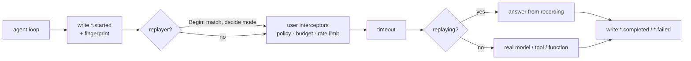

# Architecture

How agentflow records agent runs, and how it replays them against new code.

## The idea in one paragraph

Everything nondeterministic an agent does goes through one **effect boundary**: model calls, tool calls, context lookups, and anything wrapped in `agentflow.Do`. At the boundary each effect is recorded in a **trace**: its request (with a fingerprint) and its outcome. Replay runs your *current* code against a recorded trace. Every effect request the new run makes is compared with the recording. A match is answered from the recording without touching the world. The first mismatch is a **divergence**, reported down to the field that changed.

## Concepts

| Term | Meaning |
|---|---|
| **Trace** | Everything recorded for one top-level invocation. A replay produces a new trace whose *origin* points back to the source. |
| **Run** | One execution of one task by an agent. Runs in a trace form a tree; each has a path (`/` for the root). |
| **Event** | One immutable record in a run, numbered by `seq` (0, 1, 2, …), with no gaps. Order comes from `seq`, never from timestamps. |
| **Effect** | An interaction with the outside world, recorded as a `*.started` event and a `*.completed` / `*.failed` event. |
| **Conversation** | The messages a run has accumulated, defined exactly by its `message.appended` events. |

## Packages

```
agentflow/            Agent, Run, effect boundary, interceptors, Do/Now/NewID
  llm/                messages and content blocks, Request/Response, the Model interface (stdlib only)
  trace/              event format, canonical JSON + fingerprints, conversation fold, Store, Writer, bundles
  trace/canonical/    RFC 8785 JSON canonicalization
  trace/filestore/    JSONL file store with content-addressed blobs
  trace/memstore/     in-memory store
  replay/             replay engine, divergence reports, trace diff
  policy/             interceptors: permissions, token budget, rate limit
  agentflowtest/      scripted models and cassettes for go test
  schema/             JSON Schema validation of tool inputs
  mcp/                MCP client: server tools as agentflow tools
  cmd/agentflow/      CLI: runs, show, diff, export
  providers/          separate modules: anthropic, openai, retry
  observe/otel/       separate module: OpenTelemetry tracer and metrics observers
```

Providers depend only on `llm`, never on the runtime. The core modules depend on the standard library plus `google/uuid`.

## The agent loop

```
run.started, message.appended(task)
loop (up to MaxSteps):
    context providers  ──► effect "context.<name>"   (ephemeral messages for this call)
    model call         ──► llm.started / llm.completed, message.appended
    no tool calls?     ──► run.finished(completed)
    tool calls         ──► tool.started × n  →  run (concurrently if allowed)  →  tool.completed × n
                           message.appended(tool results)
```

Tool calls from one model response form a **batch**. All `tool.started` events are written in response order, the tools run (up to `MaxParallelTools` at once), and the completions are written in response order. A trace's layout therefore never depends on which tool finished first, or on the parallelism setting.

## The effect boundary

Every effect follows the same path:



- **Interceptors** may allow, deny, delay or observe a call, but never change its request. That guarantees the recorded request is the one sent.
- **Recordable failures vs aborts.** A failure that happened in the world is an outcome: it is recorded and replayed. Examples are a rate-limited model, a tool timeout, or a policy denial. A Go error from an interceptor means the runtime itself failed, and it aborts the run.
- **Panics** in tools, providers and context providers are recovered and recorded as failures.
- **Interceptor-produced outcomes are marked.** If an interceptor answered a call (e.g., a denial), the completion carries `"intercepted": true`. Replay never serves such an outcome as a world result. If the call now reaches the world, for example because the policy was removed, that is a divergence.

## Determinism rules

1. The runtime touches the world only through the boundary.
2. No decision depends on wall-clock time, randomness or map order. Clock and ID sources are injected, and are used only for event times and IDs, which are never compared.
3. Tool specs are sorted by name in every request.
4. Interceptors don't modify requests.
5. Tool batches record in response order.
6. Effects nested inside a tool call (a `Do` made by a tool) are buffered and written with their tool's completion. A concurrent `Do` on the same run outside a batch fails with `ErrConcurrentEffect` instead of producing a nondeterministic trace.

## Recording format

The full specification, written for implementers in any language, is [docs/spec/trace-v1.md](docs/spec/trace-v1.md), with a [JSON Schema](docs/spec/trace-v1.schema.json). CI validates the encoder and every committed fixture against the schema. In brief, each event is one JSON line:

```json
{"v":1,"trace_id":"…","run_id":"…","seq":5,"time":"2026-11-23T10:00:00.123456Z","kind":"tool.started","cause":3,
 "body":{"step":0,"call_id":"toolu_01","tool":"calculator","input":{"expression":"6*7"},"fingerprint":"sha256:…"}}
```

- **`cause`** links an event to the event it answers: a completion to its start, a tool call to the model response that requested it.
- **Requests are references.** `llm.started` records how many conversation messages the call used, plus any ephemeral messages and a fingerprint, instead of a copy of the whole history. `trace.Request(events, seq)` rebuilds the exact request. Storage grows linearly with run length.
- **Fingerprints** are SHA-256 of the RFC 8785 canonical JSON of what was sent to the model, so two requests compare equal exactly when they would be sent identically.
- **Content blocks** keep everything providers send, including reasoning blocks with their signatures, which must be sent back unchanged.
- **Large strings** (over 32 KiB by default) move to a content-addressed blob store, so identical payloads are stored once. Stores always return events with blobs resolved.
- **Redaction** (opt-in, e.g. `trace.SecretPatterns`) replaces matching values in stored files. Fingerprints are computed before redaction, so replay matching stays exact.
- **File store layout:** `traces/<trace_id>/<run_id>.jsonl` plus `blobs/sha256/…`, with `0700`/`0600` permissions. A line cut off by a crash is dropped on read, and the run is reported as incomplete.

## Replay

`replay.Run(ctx, agent, store, traceID, opts)` builds a **tape** from the recorded run. The tape indexes effects by key:

- **LLM calls:** `llm#0`, `llm#1`, … by position.
- **Tool calls:** `tool:<call_id>`, with `#n` added for a repeated ID.
- **Custom effects:** `effect:<name>#<n>`.

It then runs the agent with a replayer installed. As each effect starts, the replayer looks up its key and compares fingerprints:

| Situation | Result |
|---|---|
| Same fingerprint | Answered from the recording |
| Different fingerprint | `request_mismatch`, with a field-level diff (e.g. `system[0].text`, `tools{calc}.input_schema…`) |
| No recorded effect with that key | `unexpected_effect` |
| Recorded effects never reached | `missing_effect` (checked when the run ends) |
| All effects match but the output differs | `output_mismatch` |

What happens after a divergence:

- **Stop** (default): the run ends with status `diverged`.
- **GoLive:** this and every later effect go to the real world. The switch is recorded as `run.mode_changed`.
- **Ignore:** keep serving recorded outcomes. Every divergence is still reported.

**Limits of replay.** Replay checks what your code *asks for* and what it *does with the answers*. Effect outcomes come from the recording, so a changed tool implementation or memory backend isn't detected; only changes to their inputs are.

**Cassettes.** `agentflowtest.Cassette(t, path, agent, task)` turns a recorded bundle into a regression test. When the file is missing and recording is enabled, it records the bundle. Otherwise it replays strictly and fails the test with the divergence report. A strict replay can never reach a real model or tool.

## Observing

`trace.Observer`s receive every event after it is stored. The OpenTelemetry module provides a `Tracer` (spans with `gen_ai.*` attributes, timed from the recorded events) and `Metrics` (call counts, tokens, latencies). Anything that must *change* behavior is an interceptor, not an observer.

## Design decisions

- **Sequence numbers, not timestamps.** Timestamps tie, and concurrent work interleaves arbitrarily. `seq` gives each run a total order defined by the format itself.
- **An explicit conversation log.** History could be rebuilt from tool results, but then reading an old trace would depend on the reader's formatting code. Explicit `message.appended` events make every recorded request exact. Blob deduplication keeps the duplicated tool output cheap.
- **Replay current code, don't rebuild the agent from the trace.** Rebuilding guarantees a match and catches nothing. Running the code you have is what catches regressions.
- **Match when an effect starts.** Calls a policy denies never reach the replayer, so matching happens before interceptors run. Each recorded effect is then consumed exactly once, whatever the interceptors do.
- **Policy runs in replay.** Policies are code, not world state, so a change to a policy should be caught like any other change.
- **JSONL over a database.** `cat | jq` works on any trace, and there is no database dependency. A SQLite store can be added as a separate module.
